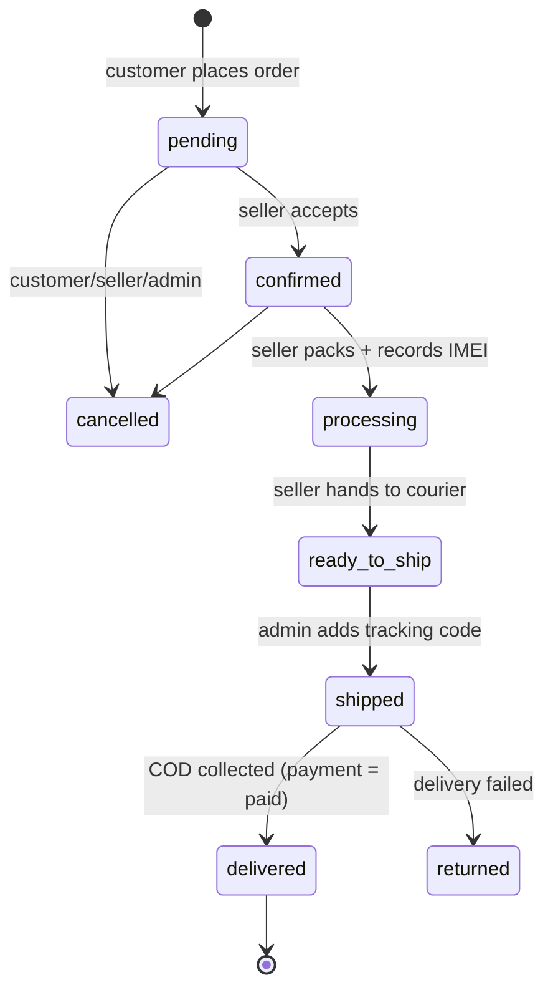

# Project overview

**DOC-01** · Owner: Chathuka Jayasekara · Status: Draft v1.0

## 1. Problem
Tech shops in Sri Lanka sell mostly through walk-ins and social media. Product information is scattered, specs are incomplete, stock is updated by hand and orders arrive by phone or chat. Customers cannot compare shops or track deliveries, and many prefer to pay only on delivery.

## 2. Solution
Teleshop is one marketplace where verified mobile, computer and accessory shops list products with **structured specifications and variants**. Customers order with **Cash on Delivery** and track each package with a **courier tracking code** that links to the courier's website.

## 3. Roles

| Role | Can do |
| --- | --- |
| **Guest** | Browse, search, compare, add to cart, track an order with order no. + phone |
| **Customer** | Everything a guest can + checkout (COD), addresses, wishlist, orders, reviews, profile |
| **Seller** (verified shop) | Shop profile, products + variants, stock, accept/pack orders, record IMEI/serial, mark ready to ship, payouts view |
| **Admin** | Verify sellers, manage catalogue, all orders, **add courier tracking codes**, mark COD paid, reviews, reports, audit logs, settings (2FA required) |

## 4. Version 1.0 scope

**In scope**
- Storefront: home with **3D hero slider** (phone, PC, headset `.glb`), categories, shop listing with spec filters, product page with variants, compare (up to 4), seller shop page.
- Cart (guest + saved), wishlist, saved addresses, checkout with COD, multi-seller orders split into packages.
- Order tracking: status timeline, courier + tracking code + courier link, guest lookup page.
- Accounts: email/password, Google sign-in, email verification, password reset, profile photo.
- Seller portal: dashboard, products & stock, orders & fulfilment, payouts summary, shop settings.
- Admin console: dashboard, orders, shipments/tracking codes, products, categories & brands, inventory, customers, sellers approval, reviews, reports, couriers, settings, audit logs.
- Responsive design: desktop, tablet, phone.

**Out of scope (later versions)**
- Online card payments, automatic courier API sync, mobile apps, live chat, multi-currency, automated payouts.

## 5. Order lifecycle

Each **package** (one seller's items in an order) has its own status. The order status is derived from its packages.

## 6. Success measures (first 3 months)
- 50 verified sellers, 5,000 products listed.
- Checkout success rate > 95 %, p95 page load (LCP) < 2.5 s on 4G.
- 100 % of shipped packages have a tracking code within 6 hours of hand-over.
- Zero critical security findings in the pre-launch review.
