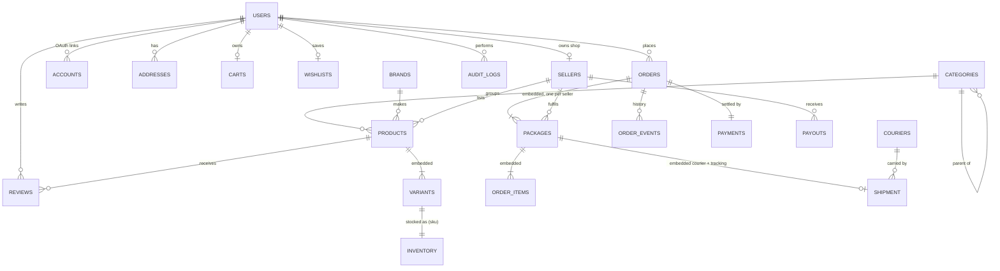

# Data Model & Database

**Teleshop Docs | DOC-08 — Data Model & Database**

| Field | Value | Field | Value |
| --- | --- | --- | --- |
| **Document ID** | DOC-08 | **Owner** | Tech Lead |
| **Version / Date** | v0.2 / 2026-10-22 | **Status** | Implemented in Phase 1 (`src/db/models`, migrations 0001–0003) |
| **Database** | MongoDB Atlas (replica set, MongoDB 7+), database `teleshop` | **Source of truth** | `src/db/models/*.model.ts` + `src/db/migrations/*.ts` |

> **Keep this file in step with the database.** Every PR that adds or changes a model, index or migration updates this file in the same PR: the collection catalogue (§3), the services (§5) and the migration log (§7). The unit test `tests/unit/data-model-doc.test.ts` fails if a model or migration is missing here.

## Contents

1. [How the data is organised](#1-how-the-data-is-organised)
2. [Entity relationship diagram](#2-entity-relationship-diagram)
3. [Collection catalogue](#3-collection-catalogue)
4. [Security model](#4-security-model)
5. [Services that write data](#5-services-that-write-data)
6. [Conventions and deliberate deviations](#6-conventions-and-deliberate-deviations)
7. [Migration log](#7-migration-log)
8. [How to change the database](#8-how-to-change-the-database)

## 1. How the data is organised

Four groups:

| Group | Collections | Key field |
| --- | --- | --- |
| **Platform** | `settings`, `couriers`, `counters`, `audit_logs` | — |
| **Identity** | `users`, `accounts`, `verification_tokens`, `password_resets` | `userId` |
| **Catalogue** (seller-owned) | `sellers`, `categories`, `brands`, `products`, `inventory`, `reviews` | `sellerId` |
| **Commerce** (customer-owned) | `addresses`, `carts`, `wishlists`, `orders`, `order_events`, `payments`, `payouts` | `customerId` / `sellerId` |

**Four rules keep the numbers right:**

1. **Server-side money.** Prices and totals are always read from `products` and recalculated on the server. Money is stored as **integer cents** (`priceCents: 38990000` = LKR 389,900.00).
2. **Stock is reserved in a transaction.** `inventory.available` must stay ≥ 0. Placing an order does a conditional `$inc` inside `withTransaction`; if any line fails, the whole order fails.
3. **Snapshots on orders.** Order items copy name, variant label, price and warranty at purchase time. Later product edits never change past orders.
4. **Append-only history.** `order_events` and `audit_logs` are insert-only (the repository has no update/delete methods, and the app DB user has no `remove` privilege on them — see §4).

## 2. Entity relationship diagram

`VARIANTS → INVENTORY` is linked by `sku` (unique), not by an ObjectId, so stock can be updated without loading the product.

## 3. Collection catalogue

All documents have `_id: ObjectId`, `createdAt`, `updatedAt` (Mongoose `timestamps: true`) unless noted. **Money** = integer cents (`…Cents`). **Writes** says which service may change the collection.

### 3.1 Platform

#### `settings`
Single document `_id: "global"`. `deliveryFeeCents` (default 45000), `expressFeeCents` (95000), `codEnabled` (true), `autoCancelHours` (48), `platformFeeBp` (300 = 3 %). Read: server only. Writes: `settings.service.update` (admin).

#### `couriers`
| Field | Type | Notes |
| --- | --- | --- |
| `name` | string, unique | `Prompt Xpress`, `Domex`, `Koombiyo`, `Pronto` |
| `codePattern` | string | regex source, e.g. `^PX-\d{4} \d{4} LK$` — validates tracking codes |
| `trackingUrlTemplate` | string | `https://promptxpress.lk/track?code={code}` — `{code}` is URL-encoded |
| `isActive` | boolean | |
Writes: `couriers.service` (admin).

#### `counters`
`_id` = counter name (`order:2026`), `seq` number. `findOneAndUpdate({ _id }, { $inc: { seq: 1 } }, { upsert: true })` gives order numbers `TS-2026-000123`. Writes: `orders.service` only.

#### `audit_logs` (append-only)
| Field | Type | Notes |
| --- | --- | --- |
| `actorId` | ObjectId → users | |
| `actorRole` | enum | `customer`, `seller`, `admin`, `system` |
| `action` | string | `seller.approve`, `order.tracking.add`, `product.block`, `inventory.adjust`, `user.suspend`, `payment.mark_paid`, `auth.login` |
| `entity`, `entityId` | string | |
| `data` | object | before/after summary — **never** passwords, tokens or full addresses |
| `ipHash` | string | SHA-256 of IP + daily salt |
| `createdAt` | Date | no `updatedAt` |
Indexes: `{ createdAt: -1 }`, `{ actorId: 1, createdAt: -1 }`, `{ entity: 1, entityId: 1 }`. TTL: none (kept 12 months, archived by a monthly job). Writes: `audit.log()` only.

### 3.2 Identity

#### `users`
| Field | Type | Notes |
| --- | --- | --- |
| `email` | string, unique, lowercase | |
| `emailVerified` | Date \| null | Auth.js field |
| `name` | string | |
| `phone` | string | `+947XXXXXXXX` |
| `image` | string | profile photo URL (Upstash Blob) |
| `passwordHash` | string \| null | Argon2id; null for Google-only users. `select: false` |
| `role` | enum | `customer` \| `seller` \| `admin` |
| `status` | enum | `active` \| `suspended` |
| `tokenVersion` | number | bump to invalidate all sessions (JWT carries it) |
| `twoFactor` | `{ enabled, secretEnc, recoveryHashes[], lastStep, proofHash, proofExpires }` | admins must have `enabled: true`; secret AES-256-GCM encrypted; recovery codes SHA-256, single use; `lastStep` blocks code replay; `proofHash` = one-time 60 s proof that upgrades the session after a correct code (added v0.3). `select: false` |
| `failedLogins`, `lockedUntil` | number, Date | lock 15 min after 5 failures |
| `lastLoginAt` | Date | |
Indexes: `{ email: 1 }` unique, `{ role: 1, status: 1 }`. Writes: `auth.service`, `users.service`.

#### `accounts`
Auth.js OAuth links (`provider`, `providerAccountId`, `userId`). Unique `{ provider: 1, providerAccountId: 1 }`. Tokens not stored (we do not call Google APIs).

#### `verification_tokens`
Email verification. `identifier` (email), `tokenHash` (SHA-256), `expires`. TTL index on `expires`.

#### `password_resets`
`userId`, `tokenHash` (SHA-256 of a 32-byte random token), `expiresAt` (30 min), `usedAt`. TTL index on `expiresAt`. A token is single-use.

### 3.3 Sellers and catalogue

#### `sellers`
| Field | Type | Notes |
| --- | --- | --- |
| `userId` | ObjectId → users, unique | shop owner |
| `shopName`, `slug` | string, `slug` unique | `istore-colombo` |
| `shopType` | enum | `mobile_shop`, `computer_shop`, `accessories_shop`, `general_tech` |
| `businessRegNo` | string | |
| `address` | `{ line1, city, district, postalCode }` | |
| `phone`, `description`, `logoUrl` | string | |
| `approvalStatus` | enum | `pending`, `approved`, `rejected`, `suspended` |
| `rejectionReason`, `approvedBy`, `approvedAt` | | |
| `settings` | `{ acceptsCod, vacationMode, autoAccept, dispatchDays }` | |
| `documents` | `[{ kind: business_registration, path, contentType, size, uploadedAt }]` | ≤ 5; the file is AES-256-GCM encrypted in storage ([ADR-006](adr/ADR-006-encrypted-seller-documents.md)); admin-only, never selected by public queries (v0.4) |
| `payoutAccount` | `{ bank, branch, last4 }` | full account number is **not** stored here — kept only by the payment provider/offline |
| `establishedYear` | int | year the shop opened ("Since 2019") — added v0.2 |
| `coverUrl` | string | wide shop photo at the top of the shop page — added v0.3 |
| `photos` | `[{ url, alt, width, height }]` ≤ 6 | shop gallery (storefront, interior) — added v0.3 |
| `location` | `{ lat, lng }` \| null | map pin + "Get directions" on the shop page — added v0.3 |
| `openingHours` | string ≤ 80 | e.g. "Mon–Sat 9.00–19.00" — added v0.3 |
| `tags` | string[] ≤ 5 | short display tags ("Phones", "Apple") — added v0.2 |
| `rating` | `{ average, count }` | cached from reviews |
Indexes: `{ slug: 1 }` unique, `{ approvalStatus: 1 }`. Writes: `sellers.service` (owner edits profile; admin approves).

#### `categories`
`name`, `slug` (unique), `parentId` → categories (null = main), `icon` (UI tile icon: `phone`, `laptop`, `cpu`, `headphones`, `watch`, `monitor`, `gamepad`, `wifi` — added v0.2), `specTemplate[]` (`{ key, label, type: text|number|select, unit, options[], filterable }`), `requiresSerial` (true for phones, laptops — seller must record IMEI/serial before ready to ship), `imageUrl`, `sortOrder`, `isActive`. Index `{ parentId: 1, sortOrder: 1 }`. Writes: admin.

#### `brands`
`name` (unique), `slug` (unique), `logoUrl`, `isActive`. Writes: admin.

#### `products`
| Field | Type | Notes |
| --- | --- | --- |
| `sellerId` | ObjectId → sellers | owner |
| `categoryId`, `brandId` | ObjectId | |
| `name`, `slug` | string, `slug` unique | |
| `shortName` | string ≤ 60 | compact name for phone cards / cart lines — added v0.2 |
| `shortDescription`, `description` | string | description is plain text (rendered escaped — sellers cannot post HTML) |
| `highlights` | string[] ≤ 6 | key selling points on the product page — added v0.2 |
| `condition` | enum | `new`, `used`, `refurbished` |
| `specs` | Map<string,string> | keys from the category `specTemplate`, validated in the service |
| `images` | `[{ url, alt, width, height }]` | max 8 |
| `variants` | `[Variant]` embedded | see below |
| `basePriceCents` | number | lowest active variant price (cached, for sorting) |
| `freeDelivery` | boolean | seller pays delivery; package ships free only if all its items do — added v0.2 |
| `warranty` | `{ months, type: manufacturer|shop|none }` | |
| `status` | enum | `draft`, `pending_review`, `published`, `inactive`, `blocked` |
| `moderationNote` | string \| null | why an admin sent the product back to draft or blocked it; shown to the seller (v0.4, P7-T03) |
| `rating` | `{ average, count }` | cached |
| `publishedAt` | Date | |
**Variant:** `{ _id, sku (unique), label: "256GB / Cosmic Orange", attributes: Map { storage, ram, colour, size… }, priceCents, compareAtCents, imageUrl, isActive }`. A product has 1–50 variants with no duplicate SKUs.
Indexes: `{ slug: 1 }` unique; `{ 'variants.sku': 1 }` unique; `{ status: 1, categoryId: 1, basePriceCents: 1 }`; `{ sellerId: 1, status: 1 }`; text index `{ name: 'text', 'specs.model': 'text' }` (weights name 10). Writes: `catalog.service` (seller own products; admin block/unblock).

#### `inventory`
One document per variant.
| Field | Type | Notes |
| --- | --- | --- |
| `sku` | string, unique | = `products.variants.sku` |
| `productId`, `sellerId` | ObjectId | |
| `onHand` | int ≥ 0 | physical stock |
| `reserved` | int ≥ 0 | held by open orders |
| `available` | int ≥ 0 | `onHand - reserved` (stored for atomic conditional updates) |
| `lowStockAt` | int | default 5 |
| `version` | int | optimistic concurrency |
Validator (`$jsonSchema`, added by migration 0002): `available`, `reserved`, `onHand` are ints ≥ 0. Indexes: `{ sku: 1 }` unique, `{ sellerId: 1, available: 1 }`, `{ productId: 1 }`. Writes: `inventory.service` only (inside transactions).

#### `reviews`
`productId`, `sellerId`, `customerId`, `orderId` + `itemId` (verified purchase; unique `{ orderId, itemId }`), `rating` 1–5, `title`, `comment` (≤ 2000, plain text), `status` (`visible`/`hidden`/`flagged`), `sellerReply`. Index `{ productId: 1, status: 1, createdAt: -1 }`. Writes: `reviews.service` (customer after delivery; admin moderate).

### 3.4 Commerce

#### `addresses`
`userId`, `label` (`home`/`office`/`other`), `recipientName`, `phone`, `line1`, `line2`, `city`, `district`, `postalCode`, `isDefault`. Index `{ userId: 1 }`. Max 10 per user. Writes: `users.service` (owner only).

#### `carts`
`userId` (unique where set — partial index, null for guests), `guestId` (unique where set — partial index, from a signed cookie), `items[]: { sku, qty (1–10), addedAt }`, `updatedAt`. **No prices stored.** TTL on `updatedAt` for guest carts (30 days, partial index `guestId: { $exists: true }`). Writes: `cart.service`.

#### `wishlists`
`userId` (unique), `productIds[]` (max 200). Writes: `cart.service`.

#### `orders`
| Field | Type | Notes |
| --- | --- | --- |
| `orderNo` | string, unique | `TS-2026-000123` |
| `customerId` | ObjectId → users | |
| `idempotencyKey` | string, unique | from checkout form; stops double orders |
| `deliveryAddress` | object | snapshot of the address |
| `deliveryMethod` | enum | `standard`, `express` |
| `subtotalCents`, `deliveryCents`, `discountCents`, `totalCents` | int | server-computed |
| `paymentMethod` | enum | `cod` (v1) |
| `status` | enum | derived: `pending`, `in_progress`, `shipped`, `delivered`, `cancelled`, `partially_delivered` |
| `packages` | `[Package]` embedded | one per seller |
| `placedAt`, `cancelledAt`, `cancelReason` | | |
**Package:** `{ _id, sellerId, status: pending|confirmed|processing|ready_to_ship|shipped|delivered|cancelled|returned, items[], subtotalCents, deliveryCents, shipment }`.
**Item:** `{ _id, productId, sku, name, variantLabel, imageUrl, unitPriceCents, qty, lineTotalCents, warrantyMonths, serialNumbers[] (IMEI / serial per unit, ≤ qty, set by the seller — v0.4, was a single serialNumber) }`.
**Shipment:** `{ courierId, courierName, trackingCode, trackingUrl, handedOverAt, estimatedDelivery, addedBy (admin userId), addedAt }`.
Indexes: `{ orderNo: 1 }` unique, `{ idempotencyKey: 1 }` unique, `{ customerId: 1, placedAt: -1 }`, `{ 'packages.sellerId': 1, 'packages.status': 1, placedAt: -1 }`, `{ 'packages.shipment.trackingCode': 1 }` sparse, `{ status: 1, placedAt: -1 }`. Writes: `orders.service`, `shipments.service`.

#### `order_events` (append-only)
`orderId`, `packageId` (optional), `fromStatus`, `toStatus`, `actorId`, `actorRole`, `note`, `createdAt`. Index `{ orderId: 1, createdAt: 1 }`. Powers the tracking timeline. Writes: services only, insert-only.

#### `payments`
`orderId` (unique), `method` (`cod`), `status` (`pending`/`paid`/`failed`/`refunded`), `amountCents`, `perPackage[]: { packageId, amountCents, status, collectedAt }`, `reference`, `paidAt`. Never stores card data. Writes: `payments.service` (admin marks COD paid; seller can confirm for own package).

#### `payouts`
`sellerId`, `periodStart`, `periodEnd`, `orderCount`, `grossCents`, `feeCents`, `netCents`, `status` (`scheduled`/`paid`), `paidAt`, `reference`. Unique `{ sellerId: 1, periodStart: 1 }`. Writes: `payouts.service` (admin / scheduled job).

## 4. Security model

MongoDB has no row-level security, so access control is enforced in **three layers**:

| Layer | What it does |
| --- | --- |
| **Database users** (Atlas) | `teleshop_app`: `readWrite` on `teleshop` only (used by Vercel). `teleshop_migrator`: `readWrite` + `dbAdmin` on `teleshop` (used only by `pnpm db:migrate` / `db:indexes` in CI). `teleshop_readonly`: `read` for analytics. No user has cluster-admin. A custom role removes `remove` on `audit_logs` and `order_events` for `teleshop_app`. |
| **Service layer** | Every service starts with `requireRole()` and an ownership check: sellers are always filtered by `sellerId = session.sellerId`; customers by `customerId = session.userId`. Repositories accept the owner id as a required argument for owned data. |
| **Schema** | Mongoose `strict: 'throw'`, Zod at the boundary, `sanitizeFilter: true` on the connection, `$jsonSchema` validators on `orders` and `inventory` as a second guard. |

Other rules:
- Sensitive fields are `select: false` (`passwordHash`, `twoFactor`). DTO mappers never include them.
- Tokens (reset, verification) are stored **hashed**; only the email contains the raw token.
- Atlas: TLS required, encryption at rest (default), IP access list, database auditing on M10+, continuous backups on production.

## 5. Services that write data

| Service function | Collections written | Guard |
| --- | --- | --- |
| `auth.register` | users, verification_tokens | public + rate limit |
| `auth.resetPassword` | users, password_resets | token |
| `sellers.apply` / `sellers.approve` | sellers, users(role) , audit_logs | customer / admin |
| `catalog.upsertProduct` | products, inventory | seller (own) |
| `catalog.setProductStatus` | products, audit_logs | admin (`blocked`), seller (`draft`/`inactive`) |
| `inventory.adjust` | inventory, audit_logs | seller (own) / admin |
| `cart.addItem` / `updateQty` / `merge` | carts | owner / guest cookie |
| `orders.placeOrder` | orders, inventory, payments, order_events, carts, counters | customer (transaction) |
| `orders.cancel` | orders, inventory, order_events | customer (before shipped) / seller / admin |
| `fulfilment.accept` / `pack` / `recordSerial` / `markReady` | orders.packages, order_events | seller (own package) |
| `shipments.addTrackingCode` | orders.packages.shipment, order_events, audit_logs | admin |
| `payments.markPaid` | payments, orders, inventory (reserved → sold), order_events | admin |
| `reviews.create` / `moderate` | reviews, products.rating, sellers.rating | customer (delivered) / admin |

## 6. Conventions and deliberate deviations

- **Money:** integer cents, currency LKR only in v1. Helper `src/lib/utils/money.ts`.
- **IDs:** ObjectId everywhere; `orderNo` and `sku` are the human-readable keys.
- **Embedding vs referencing:** variants, order packages, items and shipments are **embedded** (bounded size, read together). Inventory is a **separate** collection on purpose, so stock can be updated atomically and often without rewriting product documents.
- **Soft delete:** products and users are never hard-deleted; use `status`.
- **Denormalised caches:** `products.rating`, `sellers.rating`, `products.basePriceCents` — always updated by the service that changes the source data.
- **Dates:** stored in UTC; displayed in `Asia/Colombo`.
- **Query operators:** `sanitizeFilter` neutralises every `$`-object in find/update filters — including query-builder ones. Operators we write ourselves use the trusted helpers in `src/db/operators.ts` (`$in`, `$gt`, `$ne`…); aggregation pipelines are not sanitised, so they only use Zod-validated values. Integration-tested in `tests/integration/db/mongoose.test.ts`.
- **Repositories** (`src/db/repositories/*`): `product`, `category`, `brand`, `seller`, `order` (tracking), `user` (never selects `passwordHash`/`twoFactor`), `settings`. They return DTOs, never Mongoose documents.

## 7. Migration log

| No. | File | What it does | Date |
| --- | --- | --- | --- |
| 0001 | `0001-init.ts` | Create collections, all indexes in §3, TTL indexes | 2026-10-22 |
| 0002 | `0002-validators.ts` | `$jsonSchema` validators for `orders` and `inventory` (ints ≥ 0 via `multipleOf: 1`, `orderNo` pattern, ≥ 1 package) | 2026-10-22 |
| 0003 | `0003-seed-couriers-settings.ts` | Insert couriers + `settings.global` (`$setOnInsert` — never overwrites admin edits) | 2026-10-22 |
| 0004 | `0004-demo-product-images.ts` | Attach Wikimedia Commons demo photos (`public/images/products`, credits on `/credits`) to seeded products that have no images | 2026-10-23 |
| 0005 | `0005-demo-product-photo-sets.ts` | Replace the legacy single demo photo (`<slug>.webp`, from the first 0004) with the photo set (`<slug>-1…4.webp`, backgrounds removed); seller uploads untouched | 2026-10-26 |
| 0006 | `0006-demo-shop-profiles.ts` | Cover photo, photos (Commons, credited on `/credits`), map pin and opening hours for the demo shops; only empty fields are set | 2026-10-27 |
| 0007 | `0007-fill-missing-shop-fields.ts` | Fill demo shop `photos` + `openingHours` where the field is **missing** (records older than v0.3 — 0006 only matched empty values) | 2026-10-27 |
| 0008 | `0008-order-item-serial-numbers.ts` | Order items: single `serialNumber` → `serialNumbers[]` (one IMEI/serial per unit); `down` keeps the first | 2026-10-28 |

Applied migrations are recorded in the `_migrations` collection (`_id` = migration id, `appliedAt`). Runner: `scripts/seed/migrate.ts` (`--status`, `--down <id>`); list of migrations: `src/db/migrations/index.ts`.

## 8. How to change the database

1. Change the model in `src/db/models/<name>.model.ts` (fields, validation, indexes).
2. If existing data must change, add `src/db/migrations/NNNN-short-name.ts` exporting `up(db)` and `down(db)`. Migrations must be **idempotent** (safe to run twice).
3. Update this file: §3 (fields/indexes), §5 (if a service changes), §7 (migration log).
4. Run locally: `pnpm db:migrate && pnpm db:indexes && pnpm test:int`.
5. In the PR description, state the migration and whether it needs downtime (aim for none: add fields first, backfill, then make them required).
6. Production: CI runs `pnpm db:migrate` with the `teleshop_migrator` user **before** the Vercel production deploy is promoted (see [doc 12](12-deployment.md)).
